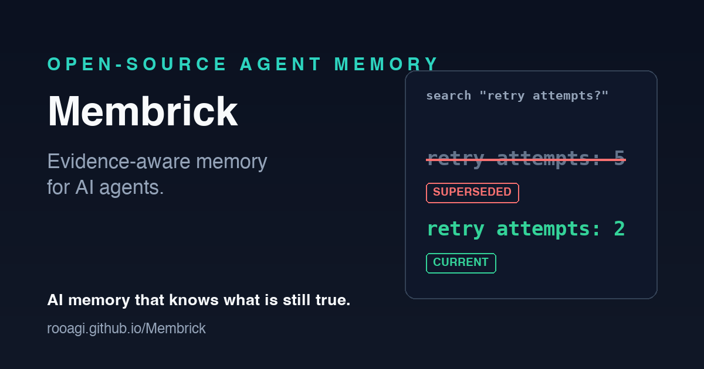

<p align="center">
  
</p>

<p align="center">
  <a href="https://github.com/RooAGI/Membrick/releases/latest"></a>
  <a href="https://pypi.org/project/membrick/"></a>
  <a href="https://pypistats.org/packages/membrick"></a>
  <a href="https://github.com/RooAGI/Membrick/blob/main/LICENSE"></a>
</p>

<p align="center">
  <a href="https://rooagi.github.io/Membrick/">Documentation</a> ·
  <a href="docs/quickstart.md">Quickstart</a> ·
  <a href="docs/agents.md">Agent integrations</a> ·
  <a href="#benchmarks">Benchmarks</a> ·
  <a href="https://github.com/RooAGI/Membrick/discussions">Discussions</a>
</p>

- MCP Registry name: `mcp-name: io.github.RooAGI/membrick`

# Membrick: persistent memory for AI coding agents

**One memory for every agent. 75% fewer tokens.**

8 agent harnesses. 1 shared project memory. No embedding, database, or
server setup.

Membrick is open-source, local-first **AI agent memory** for Claude Code,
Codex, Gemini CLI, Antigravity, Muse Code, OpenClaw, Hermes, and RooAGI
AgentFlow. It remembers your project's decisions, sessions, docs, and code
across sessions, and gives your agent the current answer instead of a stale
one. One memory, shared by every agent, stored locally in your project. No
hosted cloud, no data leaves your machine.

## The problem: your project changes its mind

Monday's doc says gateway timeout retries are 5. Friday's says 2. Both are
still in the repo, and a normal search returns either one and leaves the model
to guess.

**Membrick keeps `2` as the current answer and `5` as history.** That is the
whole point: memory that knows what is still true.

It works anywhere project truth changes over time: architecture decisions, API
contracts, config values, runbooks, ownership, terminology, plans.

## What it does

- Remembers sessions, decisions, docs, and code across sessions
- Ranks current evidence ahead of superseded guidance, with sources
- Answers "is this still true?" instead of just "is this similar?"
- Catches contradictions, stale claims, terminology drift, and orphan pages
- Stays local and inspectable: a dashboard shows what is in memory

## Quickstart

```bash
cargo install --git https://github.com/RooAGI/Membrick
membrick install claude /path/to/project
membrick query "what is the current retry policy?" /path/to/project
```

See the [CLI reference](docs/cli.md) and [full quickstart](docs/quickstart.md)
for Docker, HTTP, Python, Rust, and MCP setup.

## Agent integrations

| Integration | Project memory | Lifecycle capture | MCP tools | Replay |
|---|---:|---:|---:|---:|
| [Claude Code](docs/claude-code.md) | Yes | Yes | Yes | Yes |
| [Codex](docs/codex.md) | Yes | Yes | Yes | Yes |
| [Gemini CLI](docs/gemini-cli.md) | Yes | Yes | Yes | — |
| [Antigravity CLI / AGY](docs/agy.md) | Yes | Yes | Yes | — |
| [Muse Code](docs/muse-code.md) | Yes | Yes | Yes | — |

Plus [OpenClaw](docs/openclaw.md), [Hermes](docs/hermes.md), and
[RooAGI AgentFlow](docs/roo-runtime.md): all eight share the same
`.membrick/memory/` store, so a decision recorded by one agent is visible to
the others.

Lifecycle capture saves every transcript message into searchable turn
documents (Claude Code and Codex; other agents save what their payloads
provide), plus the session summary. Capture is verbatim: no observer LLM
compresses your sessions. `record_session` is separate, an opt-in replay log.

`membrick install` also installs 20 skills (`.claude/skills/`,
`.agents/skills/`), including `membrick-search` and `membrick-memory`, which
enforces MCP-first search. They wrap the MCP tools; they do not learn new
skills on their own. The learning signal that exists is the search-feedback
loop, reviewed in the dashboard.

All agents share one project store: `/path/to/project/.membrick/memory/`.
Legacy per-provider stores are migrated on first run.

## Dashboard

The local server serves a read-only dashboard at `/dashboard`. Find its URL in
`.membrick/server.toml` (`dashboard_url`). Four views: Overview, Index,
Providers, Search reviews. Data refreshes every five seconds.


See [observability](docs/observability.md).

## Benchmarks

LongMemEval-S, 500 questions, 2026-10-16, heuristic backend, no embeddings:
any-hit Recall@5 / @10 / @20 **96.6% / 98.8% / 100.0%**, MRR **88.85%**,
NDCG@10 **87.91%**, mean search **3.48 ms**.
[Details](docs/benchmark-results.md)

LoCoMo agentic evaluation, 1,540 questions, reader and judge both Muse, up to
5 search rounds: **78.5%** overall (single-hop 86.4%, multi-hop 60.6%,
temporal 80.7%, open-domain 54.2%). Not directly comparable to Letta's 74.0%
or Mem0's 92.5%, which use different readers, judges, and protocols. BEAM has
not been run. [Details](docs/benchmark-results.md)

Retrieval cost, same 1,540 questions, k=3: about **1,196 tokens per search**
(chars/4 estimate; median 1,198, p95 1,647), about 6,948 per question at ~5.8
searches each. Mem0 reports ~6,956 tokens per query on LoCoMo, so per search
we run ~6x lighter; per question it comes out about even.

Token savings, same `routing-decision-supersession` scenario, diagnostics not
guarantees: Claude, 3 runs per setup, fresh input tokens 128 → 32 (-75.0%),
overall tokens 2,884,478 → 605,686 (-79.0%), tool calls 65 → 14, recall 9/9.
Codex, 1 run per setup, overall tokens 313,066 → 196,102 (-37.4%), tool calls
7 → 4, recall 3/3. No single token-savings headline: the figures differ by
provider and run count.
[Claude](docs/claude-code-performance-tests.md) ·
[Codex](docs/codex-performance-tests.md)

## How it works

Sessions, docs, code, and traces go in. Facts, entities, symbols, and time
come out. Links, ownership, and supersession connect them. Search returns
ranked, sourced, current context.

Search is keyword-based plus entity and graph signals. No embeddings, no
vector database, no neural reranker. Follow-up questions inside a session get
reranked by default. Chunking is heading / line based, with a symbol index;
not AST-aware. [Details](docs/chunk-strategy.md)

## Use it from your stack

```bash
# CLI
membrick query "what is the current retry policy?" /path/to/repo

# Docker / HTTP (team server: self-hosted, token or JWT auth)
export SERVER_TOKEN=local-dev-token
docker compose up --build -d
curl http://127.0.0.1:8080/health
```

```python
import membrick
memory = membrick.Memory(path=".")  # this project's resident
memory.add([{"role": "user", "content": "Docker runs on Ubuntu hosts"}], user_id="user-1")
print(memory.search("docker ubuntu", user_id="user-1", top_k=5))
# Remote server: membrick.Memory(base_url="http://127.0.0.1:8080", api_key="local-token")
```

```rust
use membrick::{MemoryService, PipelineOptions};
let mut memory = MemoryService::in_memory(PipelineOptions::default());
// upsert documents, refresh, search_with_filters — see docs/memory-service-api.md
```

See the [HTTP server guide](docs/server.md) and
[full quickstart](docs/quickstart.md).

## Project status

Current release: **v0.10.1**, published on
[crates.io](https://crates.io/crates/membrick),
[npm](https://www.npmjs.com/package/membrick), and
[PyPI](https://pypi.org/project/membrick/). Apache-2.0.

Membrick is under active development. The release query path uses the heuristic
backend; experimental model-backed query semantics stay separate.

- [Open an issue](https://github.com/RooAGI/Membrick/issues)
- [Join a discussion](https://github.com/RooAGI/Membrick/discussions)
- [Read the documentation](https://rooagi.github.io/Membrick/)

## License

Apache-2.0
