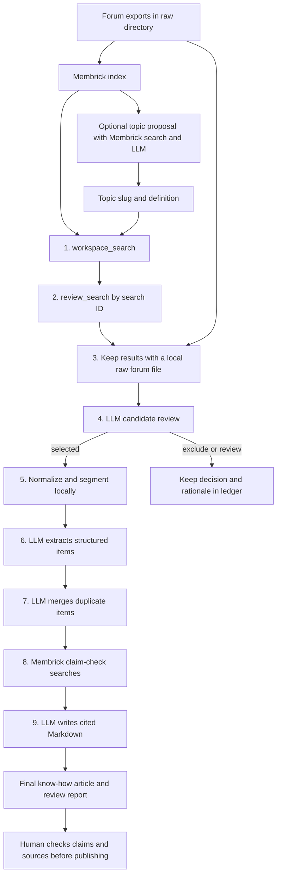

# Case Study: Retrieval-First Know-How Distillation with Membrick

**Status:** Working end-to-end pilot
**Corpus:** NVIDIA Developer Forum exports in a local `raw/` directory, indexed by Membrick
**Builder:** `spark-atlas-builder` Python pipeline

## Summary

This case study describes the workflow as it runs today. Membrick finds and records candidate forum documents; a language model reviews which local forum threads are relevant, extracts structured know-how from selected threads, merges duplicate findings, and writes cited Markdown articles. Local code handles source normalization, segmentation, validation, caching, and citation rendering.

The pipeline avoids sending the whole corpus to a model. It searches a bounded set of candidates and sends only selected threads through extraction. Membrick search results help discover and cross-check sources; a search rank or a model confidence score is never proof that a technical claim is true.

## The workflow at a glance



Each numbered stage is described below. The optional topic proposal happens before discovery when the team needs Membrick evidence to define the taxonomy.

## Step by step

### 0. Define or propose the topic

The builder can use a seed taxonomy or generate a proposal first. `propose-topics` asks a model to search Membrick, review representative documents, and return topic slugs, definitions, evidence IDs, source hashes, and coverage gaps. A proposal is stored in the work directory; it does not silently replace the configured taxonomy.

Anthropic is the default for topic proposal. `--backend local` uses the OpenAI-compatible local model endpoint. When a proposal exists in the same work directory, `topics`, `discover`, and `run` use its topic slugs and definitions.

### 1. Search Membrick for candidates

`discover` sends a bounded topic query to Membrick Python SDK `0.10.0` using `workspace_search`. Each search is saved with its exact query and `search_id`. The ranked results are leads, not a complete inventory of every relevant forum thread.

Membrick can return indexed session notes and other documents alongside forum exports. This workflow only admits a candidate when its thread ID resolves to a matching local `raw/<thread-id>/<thread-id>.md` file.

### 2. Retrieve the search review

For each search with an ID, the builder calls `review_search(search_id)` and stores the returned review with the search record. This makes the retrieval auditable and provides Membrick's source metadata. Candidate review reads the local raw export rather than relying on a short search snippet. It currently sends up to 16,000 characters per thread; selected threads are later normalized and segmented from the local source files.

### 3. Ask a model to review each candidate thread

The reviewer reads the topic definition and local thread text, then writes one of three decisions to `candidates.json`:

- `selected`: clearly in scope and likely to contain reusable technical evidence;
- `exclude`: clearly outside the topic or not a useful forum source;
- `review`: ambiguous, weakly related, or the automated review failed.

The ledger also stores the reason, confidence, model, and backend. Discovery defaults to local Qwen at `http://192.168.1.68:9802/v1/chat/completions`; `--review-backend anthropic` uses Anthropic instead. A selected thread is worth extracting. That decision does not certify its claims or fixes.

### 4. Normalize and segment selected sources locally

`run` reads only candidates marked `selected` with a matching local source file. Normalize splits each thread into posts and preserves post numbers, dates, reply relationships, and source links. Segment groups posts into model-sized inputs while retaining the thread context needed to interpret replies. These two stages make no LLM calls.

### 5. Extract structured know-how

The extraction model reads each segment and returns schema-validated records such as procedures, fixes, known issues, compatibility findings, configurations, performance reports, facts, and tips. Each record carries hardware/software scope, status, caveats, and post-level evidence. Suggestions remain suggestions unless a post confirms the result.

### 6. Merge duplicate findings

A second model stage groups items that describe the same know-how across selected threads. It combines evidence without flattening differences between hardware, model, driver, or software versions. Items that do not belong together remain separate. The pipeline validates the response and writes canonical entries with source links.

### 7. Search for related claims

After merge, the builder searches Membrick for each final entry and saves the `search_id`, results, and `review_search` response in `claim-checks.json`. These searches are counterevidence and duplication leads for a person to inspect. The code does not treat a matching result as proof, and it does not automatically resolve a contradiction from search rank alone.

### 8. Write the final know-how article

The writer model turns the canonical entries into topic pages. It drafts task-oriented sections and cites entry labels; code converts those labels to numbered footnotes using the entries' real forum post URLs. This keeps source URLs anchored to extracted evidence rather than invented by the writer.

The `run` command prints a stage summary followed by the final Markdown. It also writes the article under `kb/` and includes the article plus claim-check IDs in `knowhow/<topic>/review.md`.

### 9. Check the result before publishing

A person still needs to compare the article with the cited forum posts, especially when a procedure is risky, the source is ambiguous, or the entry is based on one report. Candidate review decides which sources are worth processing; it is not a final fact-check of the written article.

## Diagram as a data and model boundary

| Stage | Input | Model call? | Main output |
| --- | --- | --- | --- |
| Topic proposal (optional) | Membrick search/review | Yes | `topic-discovery/topics.json` |
| Candidate search | Topic and Membrick index | No, retrieval only | `searches.json` with search IDs and ranked hits |
| Candidate review | Local full forum thread and topic definition | Yes | `candidates.json` with decision, rationale, and confidence |
| Normalize and segment | Selected local forum files | No | `posts/` and `segments/` |
| Extract | Segments | Yes | `items/` with post-level evidence |
| Merge | Extracted items | Yes | `entries/` with grouped evidence and source links |
| Claim checks | Merged entries and Membrick index | No, retrieval only | `claim-checks.json` |
| Write | Canonical entries | Yes | Cited `kb/*.md` articles |

Here, **No** means the builder does not ask a generative model to perform that stage. Membrick itself may use its indexed retrieval machinery to rank search results.

### Why extraction and merge still use a model

Membrick answers retrieval questions such as which indexed documents match a query and which documents may be related. It does not currently return the builder's complete know-how records from a forum thread. Extraction asks the model to interpret the posts and produce a structured record: what happened, whether a proposed fix was actually confirmed, which hardware and software versions apply, and which post numbers support each claim.

Merge handles a different reasoning task. It compares those records across threads, decides whether two differently worded items describe the same procedure or issue, combines corroborating evidence, and keeps different setups or conflicting outcomes distinct. Search rank can find possible matches, but cannot make that merge decision safely on its own.

The current implementation therefore uses a model for both stages, while limiting calls to the selected threads and caching completed results. A local run still uses an LLM: `--backend local` sends the extraction, merge, and writing requests to local Qwen instead of Anthropic. Removing those calls would require a separate workflow that either asks a person to create and merge the structured records or replaces the semantic decisions with explicit deterministic rules.

## Running the workflow

Run these commands from the builder repository, the directory containing `distill/`. Use the same work directory for every step so a generated topic proposal and its ledgers remain available.

```bash
python -m distill.knowhow propose-topics \
  --backend local \
  --membrick-root <membrick-workspace> \
  --work <work-directory>

python -m distill.knowhow topics --work <work-directory>

python -m distill.knowhow discover \
  --topic <topic-slug> \
  --membrick-root <membrick-workspace> \
  --raw <forum-export>/raw \
  --work <work-directory>

python -m distill.knowhow run \
  --topic <topic-slug> \
  --membrick-root <membrick-workspace> \
  --raw <forum-export>/raw \
  --work <work-directory> \
  --backend local
```

`propose-topics` is optional if the taxonomy is already defined. Topic proposal defaults to Anthropic; discovery's candidate reviewer defaults to local Qwen; processing defaults to Anthropic and uses `--backend local` to select Qwen. Anthropic remains available for discovery review with `--review-backend anthropic`. The local endpoint and model can be overridden with `KNOWHOW_LOCAL_ENDPOINT` and `KNOWHOW_LOCAL_MODEL`, or with the relevant command-line flags. Set `KNOWHOW_LOCAL_API_KEY` only if the local server requires it.

The `PATH=/path/to/membrick/target/debug:$PATH` override is only needed when deliberately testing a locally built Membrick executable. It chooses the Membrick runtime; it does not choose the LLM. The `--backend` or `--review-backend` flag controls model routing.

## Files produced

```text
<work>/
├── topic-discovery/
│   ├── topics.json                 # optional proposed taxonomy
│   └── membrick-audit.json         # proposal search/review calls
├── triage/<topic>/
│   ├── searches.json               # query, search ID, ranked results, review
│   ├── candidates.json             # local forum candidates and LLM decisions
│   └── triage.md                   # readable candidate report
├── knowhow/<topic>/
│   ├── posts/ and segments/        # normalized source and model-sized inputs
│   ├── items/ and entries/         # extracted items and merged know-how
│   ├── claim-checks.json           # Membrick search IDs and evidence leads
│   └── review.md                   # final article plus review notes
└── kb/
    ├── README.md                   # article index
    └── <topic>.md                  # final know-how pages
```

Extraction, merge, and write results are cached by input, prompt version, and backend/model identity. A message such as `4 cached, 0 to run` means that processing stage reused saved model outputs; it did not call the model again. Changing the input, prompt version, backend, model, or local endpoint selects a different cache identity. Discovery is separate: running it again performs fresh Membrick searches and candidate-review calls.

## A completed setup-topic pilot

In a November 2026 run for `initial-setup-and-network-configuration`, Membrick retrieval produced four candidates that had matching local forum exports. The local Qwen reviewer marked all four `selected`. The processing run normalized and segmented four threads, extracted 11 items, merged two duplicate groups into four final entries, and wrote one page: `kb/setup.md`. Extraction, merge, and writing reported no failed model responses.

The writer assigned the entries to the configured `setup` topic, even though discovery used the more specific topic slug. The generated page therefore uses the filename `setup.md`. This pilot demonstrates that the stages connect end to end; four candidates do not establish complete search coverage or validate the LLM reviewer's accuracy.

An earlier manually labeled sample audited 12 candidates across three topics and reported macro-F1 of 0.89. That was a small retrieval-triage demonstration, not an evaluation of the current LLM reviewer. The excluded documents were sampled from retrieved neighborhoods, so the result says nothing about relevant threads Membrick did not retrieve.

## What the workflow establishes—and what it does not

- Membrick search and `search_id` review keep candidate retrieval auditable.
- Requiring a local `raw/` source keeps indexed session memories from being mistaken for forum evidence.
- Candidate LLM review reduces manual selection work, but its decision is about relevance, not truth.
- Extraction and writing preserve post URLs and evidence markers, but model-generated wording can still overstate what a post proves.
- Claim-check searches can reveal related or contradictory documents, but retrieval alone does not resolve those conflicts.
- A bounded top-k search is not an exhaustive corpus scan. Audit query coverage and inspect known relevant examples before claiming completeness.
- Cached stages save repeated model calls; inspect the backend/model cache identity when behavior differs between runs.

Before publishing a knowledge base, review the final page and citations against the complete source posts. Keep one-report findings and unresolved questions clearly labeled, and separate different hardware or software scopes instead of turning them into universal instructions.
