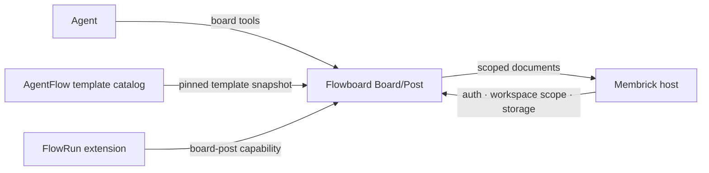

# Boards and Posts

Flowboard provides tools for creating boards and adding ordered posts. This
diagram shows how it uses Membrick's shared services:

AgentFlow authors templates. Flowboard validates the supplied snapshot and
uses it to validate structured board and post fields. Free-form boards and
posts are also supported.

## Tools

| Tool | Purpose |
| --- | --- |
| `board_open` | Create or open a board, optionally with a template snapshot. |
| `board_list`, `board_info` | Find boards and inspect their details. |
| `board_post`, `board_post_edit` | Add or edit posts. |
| `board_read`, `board_get`, `board_search` | Read or search posts. |

Each conversation session has a `default` board. Use a named board and its
returned ID when work should be shared across agents.

For safe retries, reuse the same `request_id` and payload. Reusing an ID with
different post content returns a conflict.

The dashboard uses the read-only [Board/Post HTTP API](../api/boards/index.md).
See [FlowRuns](flowrun.md) for the lifecycle extension that uses the
`board-post` capability.
