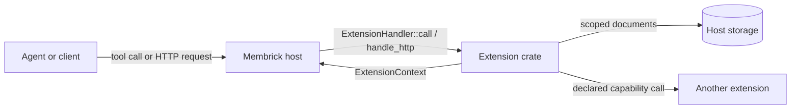
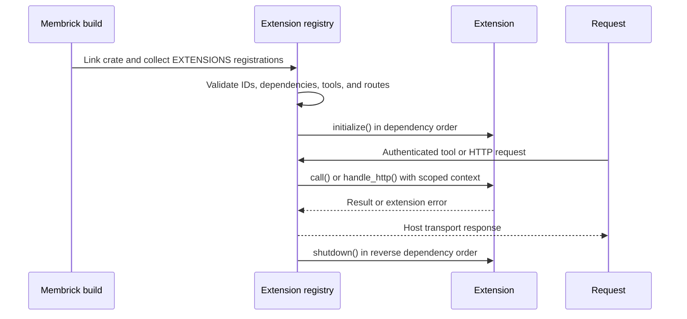

# Build a Membrick extension

An extension is a Rust crate that implements a feature and registers it with a
host. The extension owns its feature behavior and data format. The host
provides generic invocation, scoped storage, and transport services.



Membrick supplies authentication, owner/workspace scope, dispatch, and the
scoped document adapter. The extension uses `ExtensionContext` to access that
scope and to call declared capabilities.

## Required and optional parts

| Part | Required? | API |
| --- | --- | --- |
| Stable extension ID and registration | Yes | `ExtensionDescriptor`, `ExtensionRegistration`, `EXTENSIONS` |
| At least one capability | Yes | `ExtensionDescriptor::provides` |
| Tool declaration and handler | Yes for tool features | `ToolDescriptor`, `ExtensionHandler::call` |
| Capability dependencies | Only when calling another extension | `ExtensionDescriptor::requires`, `ExtensionContext::invoke` |
| Persistent feature data | Only when needed | `ExtensionContext::documents` |
| HTTP routes | Only when the feature exposes HTTP | `http_routes`, `handle_http` |
| Startup/shutdown hooks | Only when resources need lifecycle management | `initialize`, `shutdown` |

For example, Flowboard registers Board/Post and FlowRun as extensions. FlowRun
declares its dependency on the `board-post` capability and calls it through
`ExtensionContext::invoke`. Membrick dispatches the call without implementing
Board/Post or FlowRun behavior.

## How the host brings an extension to life



1. The host build enables and links the extension crate. Its
   `#[distributed_slice(EXTENSIONS)]` registration is included in the binary.
2. Membrick builds an `ExtensionRegistry` from linked registrations. Registry
   construction rejects duplicate IDs, missing or cyclic capability
   dependencies, invalid tool schemas, and overlapping HTTP routes.
3. When Membrick creates its memory service, it initializes extensions in
   dependency order before serving extension operations. A failed initializer
   shuts down already initialized extensions in reverse order and fails
   initialization.
4. For each request, the host authenticates the caller, resolves the
   owner/workspace, and dispatches through the registry with an
   `ExtensionContext` bound to that scope.
5. During orderly server shutdown, Membrick flushes pending writes and calls
   extension shutdown hooks in reverse dependency order.

The registration is static: an extension cannot be downloaded or enabled
inside an already running Membrick process. A different host can instead pass
an explicit registration set to `ExtensionRegistry::new`.

## Contributing an extension

For the current release model, an extension is contributed as source code and
included in Membrick through a reviewed change. A typical contribution:

1. Implements the extension in its own crate against
   `membrick-extension-api`.
2. Adds the crate to the selected application's dependency and composition
   point.
3. Includes focused checks for its schemas, validation, and behavior.
4. Goes through code review and CI with the rest of Membrick.
5. Ships as part of an official Membrick build.

The contributor's crate version and the extension API version describe source
and compatibility. They are not a separate runtime installation or security
approval mechanism. Compiled-in extensions run with the host's privileges;
see [Extension security](security.md).

## Minimal crate skeleton

The following is the smallest useful shape for a tool extension. Replace the
example IDs and behavior with your feature's contract.

```text
example-extension/
├── Cargo.toml
└── src/
    └── lib.rs
```

`Cargo.toml` declares the crate's own version and the host API revision:

```toml
[package]
name = "example-extension"
version = "0.1.0"
edition = "2021"

[dependencies]
membrick-extension-api = { git = "https://github.com/RooAGI/Membrick.git", rev = "448cfe267a4ebf2abb5d72376832e9aac2a2671a" }
serde_json = "1"
```

The revision shown is the API revision used by the current Flowboard
integration. Use the revision supported by your target host.

`src/lib.rs` declares the extension and registers its handler:

```rust
use membrick_extension_api::{
    distributed_slice, CapabilityId, ExtensionContext, ExtensionDescriptor,
    ExtensionError, ExtensionErrorKind, ExtensionHandler, ExtensionId,
    ExtensionRegistration, ToolDescriptor, ToolId, EXTENSIONS,
};
use serde_json::Value;

static CAPABILITIES: &[CapabilityId] = &[CapabilityId::new("example.echo")];
static TOOLS: &[ToolDescriptor] = &[ToolDescriptor {
    id: ToolId::new("example.echo"),
    description: "Return the provided JSON value.",
    input_schema: r#"{"type":"object","properties":{"value":{}},"required":["value"]}"#,
}];

static DESCRIPTOR: ExtensionDescriptor = ExtensionDescriptor {
    id: ExtensionId::new("example.echo-extension"),
    provides: CAPABILITIES,
    requires: &[],
    tools: TOOLS,
};

struct EchoExtension;

impl ExtensionHandler for EchoExtension {
    fn call(
        &self,
        _context: &mut dyn ExtensionContext,
        tool: ToolId,
        input: Value,
    ) -> Result<Value, ExtensionError> {
        match tool.as_str() {
            "example.echo" => input.get("value").cloned().ok_or_else(|| {
                ExtensionError::with_kind(
                    ExtensionErrorKind::InvalidInput,
                    "missing `value`",
                )
            }),
            _ => Err(ExtensionError::new("unknown tool")),
        }
    }
}

static HANDLER: EchoExtension = EchoExtension;

#[distributed_slice(EXTENSIONS)]
static REGISTRATION: ExtensionRegistration = ExtensionRegistration {
    descriptor: &DESCRIPTOR,
    handler: &HANDLER,
};
```

The descriptor makes the tool name and JSON Schema visible to clients. The
handler must still validate input and return an `ExtensionError` when it is
invalid. The registry checks extension, capability, tool, and route IDs for
conflicts and verifies declared capability dependencies.

## Interact with the host

`ExtensionHandler` is the extension entry point. It receives a mutable
`ExtensionContext` for each operation:

| Need | Use |
| --- | --- |
| Current owner/workspace | `context.owner()`, `context.workspace()` |
| Trusted session or caller identity | `context.session_id()`, `context.invocation_identity()` |
| Read or write extension records | `context.documents()` |
| Call another extension | `context.invoke(capability, operation, input)` |
| Add an HTTP endpoint | `http_routes()` and `handle_http()` |
| Mark writes and publish change notices | `tool_is_mutating()`, `change_notification()` |
| Acquire/release process resources | `initialize()`, `shutdown()` |
| Take over records stored before the extension existed | `legacy_record_kinds()`, `adopt_legacy_record()` |

The document interface stores generic `ExtensionDocument { id, kind, value }`
records. The host binds every read and write to the current owner/workspace;
the extension cannot widen that scope.

### Adopting older records

An extension that takes over data a host stored before the extension existed
lists the old record kinds in `legacy_record_kinds()`. When Membrick opens a
workspace, it passes each stored record whose `filters.doc_kind` matches one of
those kinds to `adopt_legacy_record()` as JSON with `doc_id`, `content` and
`filters`. The extension returns the document to store in its own scope, or
`None` for a record outside the given owner/workspace. Membrick backs the
original records up to `.membrick/migrations/`, writes the returned documents,
checks that each one reads back unchanged, and only then removes the
originals. A record the extension declines or fails to convert stays where it
is. Each kind can belong to only one extension.

### Concurrency

`ExtensionContext` is created for an invocation; it does not provide a lock.
The host controls how invocations run:

- The host may run read-only calls concurrently.
- Mark every write tool as mutating with `tool_is_mutating()`, and set
  `mutates: true` on every write route. Membrick serializes mutating calls for
  the same owner/workspace for the full invocation, including nested
  capability calls.
- Extension handlers are static and must be `Sync`. Protect any shared mutable
  state inside the extension with synchronization.

`put_batch` is atomic, but it is not compare-and-swap. Read-modify-write logic
is safe from competing extension mutations only when it runs inside the
host's serialized mutation path. Use stable request IDs and reject retries
whose payload changed. Other hosts using this API must provide the same
serialization guarantee.

Capability calls also use generic JSON. Declare the capability in
`requires`, define operation names and request/response shapes with the
provider, then call it using `context.invoke`. FlowRun uses this interface to
request Board/Post operations. Capability calls run within the host's scoped
invocation.

HTTP support is optional. A route descriptor declares its ID, method, path
pattern, and mutation behavior. `handle_http` receives decoded path
parameters, query values, and a JSON body, then returns a generic HTTP
response. Membrick owns the HTTP server, authentication, workspace selection,
and route mounting; the extension owns route behavior and response shape.

## Pre-1.0 API source migration

The extension API is pre-1.0, so source changes may require downstream crates
to update their implementations when they advance the pinned API revision.
Two recent additions affect hosts and test doubles that implement
`ExtensionContext`:

1. Implement the required `scoped_documents` method. It must return a store
   restricted to the extension named by the opaque scope token while keeping
   the host-provided owner/workspace fixed. Do not implement it by returning
   the unscoped store from `documents()`, which would let extensions share
   each other's records.
2. Add `caller_extension` wherever code constructs `InvocationIdentity`
   directly. Host-created top-level identities normally set it to `None`;
   the registry supplies the immediate caller for nested extension calls.
   Extensions should read this field only as trusted invocation attribution,
   never from tool arguments.

For example, a host context should route the opaque token to its namespace
adapter and include the new identity field:

```rust,ignore
impl ExtensionContext for HostContext {
    fn scoped_documents(
        &mut self,
        scope: &ExtensionScope,
    ) -> &mut dyn ScopedDocumentStore {
        self.documents.for_extension(scope.extension_id())
    }

    fn invocation_identity(&self) -> InvocationIdentity<'_> {
        InvocationIdentity {
            provider: &self.provider,
            principal: self.principal.as_deref(),
            caller_extension: None,
        }
    }

    // Other required methods omitted.
}
```

## Versioning and availability

Extensions are compiled into a host today. A crate is available only when the
host's final binary links it. In Membrick, the application build selects
extensions through Cargo dependencies and features. Runtime installation and
runtime version negotiation are not supported.

Use these version controls:

1. Give the extension crate its own SemVer version in `Cargo.toml` and release
   it when its public Rust API or behavior changes.
2. Pin `membrick-extension-api` to an exact Git revision until that API is
   published as a crate. Update the revision deliberately and compile against
   the target host's version.
3. Commit `Cargo.lock` for binaries so the full dependency set is reproducible.
4. Version persisted document formats inside the extension's own records. The
   host treats document kinds and values as opaque JSON.
5. Keep extension, capability, tool, and route IDs stable. Treat changes to a
   capability's operation names or JSON contract as API changes for every
   dependent extension.

The extension API crate is currently version `0.1.0` in the Membrick
repository and is not published on crates.io. Its version field alone is not
a runtime compatibility check; the Git revision and the host build determine
which API implementation is compiled.

## Link it into a host

The host build adds the extension crate as a dependency and links its
registration. In Membrick, this also means adding the dependency and feature
at the application composition point. Once linked, the generic registry
discovers the registration; Membrick does not need a feature-specific tool
dispatch branch.

A different Rust host can link the same crate and provide its own
`ExtensionContext` adapter for storage and transport. The extension can use
that host only to the extent that the adapter implements the required generic
interfaces.

## Security guardrails

| Guardrail | Enforced by | Extension author must |
| --- | --- | --- |
| Authentication and owner/workspace scope | Host transport and `ExtensionContext` storage adapter | Keep records in the provided document store; do not create an unscoped side channel. |
| Trusted caller attribution | Host supplies `invocation_identity()` and `session_id()` | Never trust provider, principal, or session values copied from tool JSON. Attribution is not authorization. |
| Capability access | Registry checks declared and registered dependencies | Declare each dependency in `requires`; validate operation names and JSON contracts. |
| Tool and route input | Host routes to the registered handler | Validate all inputs in the handler. JSON Schema is advertised to clients, not a substitute for validation. |
| Concurrent mutations | Host serializes operations marked as mutating for an owner/workspace | Mark every write tool/route as mutating; use idempotency keys for retries. `put_batch` is atomic but has no compare-and-swap. |
| Native code execution | Host build controls which crates are linked | Include only trusted extension code. An extension runs in the host process with its privileges; the compiled-in system is not a sandbox. |

The host also validates registration IDs and route conflicts before serving
extension operations. Extensions share the host process, so a bug or unsafe
dependency in an extension can affect the host. Review and update extension
dependencies like other application code.

See [Extensions](index.md) for the host model, and [Board and Post](board-post.md)
and [FlowRun](flowrun.md) for the Flowboard example. The current trust model is
described in [Extension security](security.md).
