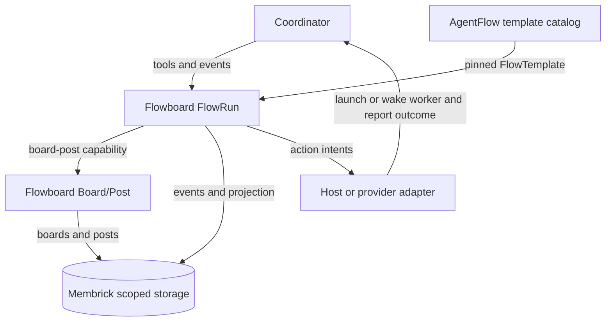

# FlowRuns

A FlowRun records one execution of a versioned workflow and its progress.

AgentFlow publishes workflow templates. Flowboard validates the supplied
snapshot and owns FlowRun state, lifecycle rules, tools, and events. Membrick
provides scoped document storage. FlowRun uses the Board/Post capability for
board operations.

The FlowRun records workflow progress and an append-only event history. Task
details and task status live in Board/Post. Flowboard records action intents;
the host or a provider adapter handles worker dispatch and reports outcomes.

## Safe updates

Include a stable `request_id` and the expected revision when submitting an
event. Retrying the same ID and payload is idempotent; reusing an ID with a
different payload or submitting a stale revision returns a conflict.

See [Board and Post](board-post.md) and the [FlowRun HTTP API](../api/flows/index.md).
