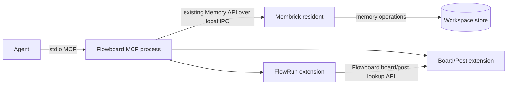

# Independent Flowboard plugin

Flowboard should be installable and runnable separately from Membrick. It
should start as its own MCP process, while Membrick's resident remains the
single owner of workspace data.

## Process layout

The Flowboard MCP process exposes the Board/Post and FlowRun tools over stdio.
Flowboard owns board/post record formats, scoped queries, and validation.
FlowRun uses a Flowboard-defined board/post lookup interface. That interface
can be an in-process service contract when shipped as one plugin, or REST if
Board/Post and FlowRun run as separate Flowboard processes. Neither extension
needs a Membrick-specific board or post API.

Installing Flowboard adds this MCP process to the agent's configuration; it
does not modify or replace the Membrick binary.

## Membrick Memory API

Flowboard can use the existing `membrick::Memory` client to reach the resident
over its supported transports. There is no need for a new client crate or for
Flowboard to implement IPC framing. The resident remains the only process
that opens the workspace store.

Use the existing `membrick::Memory` API. The standalone Flowboard host adapts
its scoped document store to that client: it serializes each extension record
as JSON in memory content and stores its Flowboard namespace, document ID, kind,
and revision in metadata. Membrick continues to treat the content as ordinary
memory text; it does not define Board/Post or FlowRun schemas. The adapter uses
a dedicated `user_id` and stable `session_id` derived from the configured
project, so Flowboard data stays separate from personal memories and remains
visible after the MCP process restarts.

## Membrick remains the data owner

Membrick must remain the only process that opens the workspace writer. The
Flowboard process must not open Membrick's files or start a second resident.
It sends document operations through a stable local IPC API, and Membrick
applies them to its existing scoped document store.

Flowboard uses a dedicated `user_id` derived from its configured workspace,
so its records stay separate from an agent's personal memories. It uses
`session_id` to group records for a workspace, board, or flow, and metadata to
identify record kinds and relationships. It uses `get` and `list` for exact
lookups and enumeration; it uses `search` only for ranked text search. The
configured workspace and Flowboard `user_id` come from process configuration,
never MCP tool arguments.

`Memory::add_transaction` atomically adds up to 128 records for one `user_id`.
The adapter writes new document revisions as adds and supersedes the previous
memory record in the same transaction. This preserves batch writes such as a
FlowRun projection plus its event. The API still has no compare-and-swap for
expected revisions. The MCP process serializes calls, so run one Flowboard
process per workspace to avoid cross-process read-modify-write races.

FlowRun reads board and post data through Flowboard's own lookup interface.
The `GET /api/boards` and `GET /api/boards/{board_id}` routes belong to
Flowboard and should be served by the Flowboard process. Today they are
registered in Membrick's router by the linked Board/Post extension; that
hosting arrangement must move for independent installation. Membrick should
not implement or require Board/Post routes.

The current Memory API does not provide a lock across a read-modify-write
sequence. Flowboard owns sequencing and revision checks and serializes its own
mutations. If multiple Flowboard processes must write the same workspace
concurrently, the existing API does not provide sufficient transaction
guarantees; that would require a separate design.

## Trust and transport

The first version targets a local user installation. The plugin binds to one
configured project and uses Membrick's existing user-private IPC endpoint.
Membrick authenticates the process and grants it only the Flowboard namespaces
it needs. The existing workspace-wide server token is not a per-plugin grant
and must not be copied into agent configuration or exposed to tool arguments.
The resident listener stays private; this design does not add a public port.

## Implementation status

The Flowboard workspace now has a standalone stdio MCP binary. It connects to
an initialized project with `Memory::new`, serves Board/Post and FlowRun tools,
and routes FlowRun board/post validation through Flowboard's lookup interface.
Its `Memory` adapter uses atomic versioned adds for extension document batches.
The development manifest currently points to the adjacent Membrick checkout so
it can use the in-progress `add_transaction` API; switch that dependency to a
released Membrick version when the method is published.

The standalone process does not yet serve the Board/Post REST routes. They
remain hosted by the linked extension path. The legacy in-process adapters also
remain for existing hosts; their removal is a separate cleanup.

This is a process boundary, not a native dynamic library loaded into Membrick.
It allows Flowboard to be installed separately while keeping workspace data
and write ownership in Membrick.
