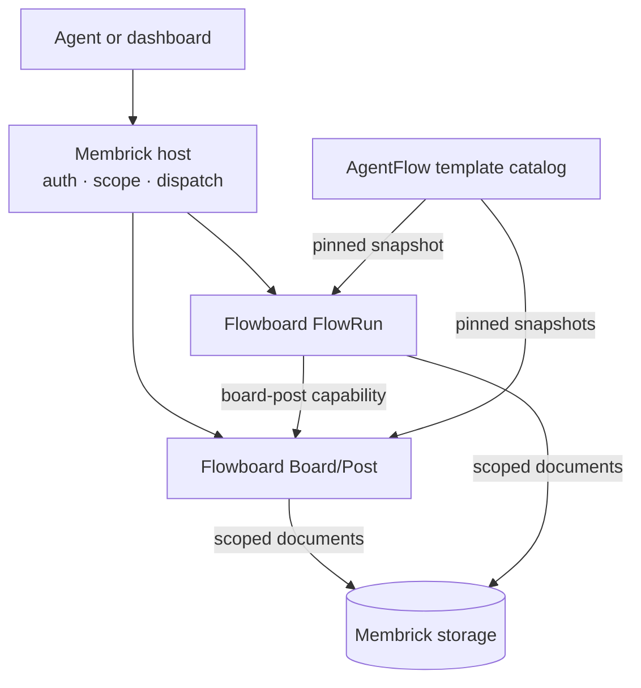

# Extensions

Membrick extensions add feature behavior to the host. The host supplies shared
services such as authentication, workspace scope, dispatch, and document
storage.

## Flowboard example

AgentFlow publishes the templates. Flowboard validates the supplied snapshots
and owns Board/Post and FlowRun behavior. Both extensions use Membrick's
owner/workspace-scoped document storage. FlowRun uses the Board/Post
capability to work with boards.

## Add an extension

Extensions are compiled into the host. To contribute one, submit its code for
review, then link it into an official Membrick build. Users cannot download or
install extension code into a running Membrick process.

See [Board and Post](board-post.md), [FlowRun](flowrun.md), or the
[extension author guide](building.md) for implementation details. The
[security guide](security.md) explains the trust boundary for compiled-in
extensions.

Flowboard now has a separate stdio MCP process in its own repository. It uses
`membrick::Memory` to reach the resident. Board/Post REST routes still use the
compiled-in host path. See the [independent Flowboard design](independent-flowboard.md).
