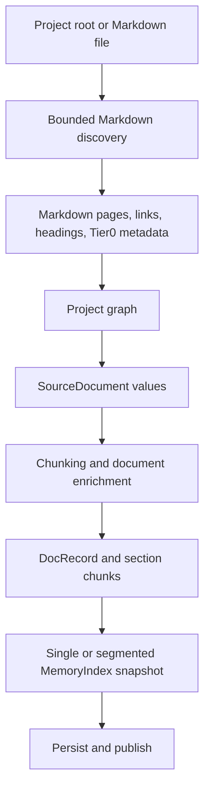

# Ingestion architecture

Membrick has two ingestion entry points that converge on the same document and
index model:

1. Project scanning reads Markdown files and turns them into searchable source
   documents.
2. Applications and agent integrations submit source documents through
   `MemoryService`. Provider captures, workspace edits, and reviewed document
   enrichment use this path.

The file adapter boundary is extensible, but Markdown is currently the only
registered filesystem adapter. Do not read the diagram as a claim that generic
code or text adapters already ship.

## Project scan and index

The project indexing CLI and resident workspace initializer share the graph
and Markdown scanning code. The CLI builds its query index from the resulting
records. The resident persists source documents through its workspace service,
which rebuilds or updates the published search snapshot. Both paths use the
same chunking and retrieval model.

## Service writes and captures

`SourceDocument` is the canonical ingestion value for application and provider
writes. It carries a stable `doc_id`, source, content, grouping, headings,
links, timestamp, filters, and optional provider-enriched key phrases.
`MemoryService::upsert` and the resident's staged writer run documents through
the same record-building and indexing pipeline. Claude Code and Codex transcript
captures retain source observations as separate documents; a generated
session-context document may link or summarize them without replacing that
evidence.

The resident owns persistent project writes. Bindings and adapters submit
operations through `Memory` or the resident integration API; they do not open
the project index directly.

## Code map

| Area | Implementation |
| --- | --- |
| File adapter interface and project graph conversion | [`src/adapters.rs`](https://github.com/RooAGI/Membrick/blob/main/src/adapters.rs) |
| Markdown discovery and parsing | [`src/adapters/markdown.rs`](https://github.com/RooAGI/Membrick/blob/main/src/adapters/markdown.rs) |
| Graph and Tier0 records | [`src/graph.rs`](https://github.com/RooAGI/Membrick/blob/main/src/graph.rs) |
| Canonical source document | [`src/source.rs`](https://github.com/RooAGI/Membrick/blob/main/src/source.rs) |
| Record building and chunking | [`src/pipeline/build.rs`](https://github.com/RooAGI/Membrick/blob/main/src/pipeline/build.rs) and [`src/chunking.rs`](https://github.com/RooAGI/Membrick/blob/main/src/chunking.rs) |
| Mutable records, snapshots, and persistence | [`src/pipeline/store.rs`](https://github.com/RooAGI/Membrick/blob/main/src/pipeline/store.rs) and [`src/pipeline/persistence.rs`](https://github.com/RooAGI/Membrick/blob/main/src/pipeline/persistence.rs) |
| Service boundary and document operations | [`src/memory_api.rs`](https://github.com/RooAGI/Membrick/blob/main/src/memory_api.rs) and [`src/memory_api/`](https://github.com/RooAGI/Membrick/tree/main/src/memory_api) |

See [Tier0 ingestion](tier0-ingestion.md) for the lightweight scan metadata,
[MemoryService](memory-service-api.md) for source-document operations, and
[index concurrency](index-concurrency.md) for staging and publication.
