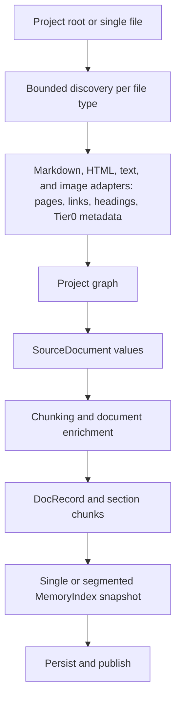

# Ingestion architecture

Membrick has two ingestion entry points that converge on the same document and
index model:

1. Project scanning reads Markdown, HTML, plain text, and described image
   files and turns them into searchable source documents.
2. Applications and agent integrations submit source documents through
   `MemoryService`. Provider captures, workspace edits, and reviewed document
   enrichment use this path.

## File types

Each file type has its own adapter under `src/adapters/`. Every adapter turns
a file into heading-structured text, so section chunking, headings, and link
resolution work the same way for all of them. Code files are not scanned.

| Files | Adapter | What is indexed |
| --- | --- | --- |
| `.md` | Markdown | The file as written, with wiki and Markdown links, headings, and frontmatter metadata such as `supersedes` and `author`. |
| `.html`, `.htm` | HTML | Readable content only. Headings become heading lines, lists, tables, code blocks and image alt text are kept, and scripts, styles and `<head>` are dropped. `<title>` is the top heading when the page has no `<h1>`, and `<meta name="author">` sets the author. |
| `.txt` | Plain text | The file name as the top heading. Long files are split at blank lines into parts of about 2,000 characters under `<name> (part N)` headings. Lines starting with `#` are escaped so they are not read as headings. |
| `.jpg`, `.jpeg`, `.png` (any case) | Image | The description in the same-named `.txt` file next to the image, for example `photo1.txt` for `photo1.jpg`. The image file itself is never read. |

Image documents use the image path as their id and source, so search results
point at the image. They carry a `media_type` filter (`image/jpeg` or
`image/png`) and record the description path in Tier0 metadata. A description
file is indexed only under its image, never again as plain text. Images
without a description are skipped. Byte limits apply to the description, not
the image, and the modified time is the later of the two files.

The scan limits (`max_files`, `max_total_bytes`) are shared across file types.
Markdown is scanned first, then HTML, plain text, and images; each gets the
budget the earlier scans left unused.

Adding, editing, or removing any of these files invalidates the workspace
index. That includes images, because adding or removing `photo1.jpg` decides
whether `photo1.txt` is a description or plain text. The watcher, the
workspace fingerprint, and the query cache fingerprint all use one shared
check, `is_indexed_source_path` in `src/adapters.rs`.

## Project scan and index

The project indexing CLI and resident workspace initializer share the graph
and file scanning code. The CLI builds its query index from the resulting
records. The resident persists source documents through its workspace service,
which rebuilds or updates the published search snapshot. Both paths use the
same chunking and retrieval model.

## Service writes and captures

`SourceDocument` is the canonical ingestion value for application and provider
writes. It carries a stable `doc_id`, source, content, grouping, headings,
links, timestamp, filters, and optional provider-enriched key phrases.
`MemoryService::upsert` and the resident's staged writer run documents through
the same record-building and indexing pipeline. Claude Code and Codex transcript
captures retain source observations as separate documents; a generated
session-context document may link or summarize them without replacing that
evidence.

The resident owns persistent project writes. Bindings and adapters submit
operations through `Memory` or the resident integration API; they do not open
the project index directly.

## Code map

| Area | Implementation |
| --- | --- |
| File adapter interface, shared file walk, and project graph conversion | [`src/adapters.rs`](https://github.com/RooAGI/Membrick/blob/main/src/adapters.rs) |
| Markdown discovery and parsing | [`src/adapters/markdown.rs`](https://github.com/RooAGI/Membrick/blob/main/src/adapters/markdown.rs) |
| HTML discovery and parsing | [`src/adapters/html.rs`](https://github.com/RooAGI/Membrick/blob/main/src/adapters/html.rs) |
| Plain text discovery and structuring | [`src/adapters/txt.rs`](https://github.com/RooAGI/Membrick/blob/main/src/adapters/txt.rs) |
| Image and description pairing | [`src/adapters/image.rs`](https://github.com/RooAGI/Membrick/blob/main/src/adapters/image.rs) |
| Graph and Tier0 records | [`src/graph.rs`](https://github.com/RooAGI/Membrick/blob/main/src/graph.rs) |
| Canonical source document | [`src/source.rs`](https://github.com/RooAGI/Membrick/blob/main/src/source.rs) |
| Record building and chunking | [`src/pipeline/build.rs`](https://github.com/RooAGI/Membrick/blob/main/src/pipeline/build.rs) and [`src/chunking.rs`](https://github.com/RooAGI/Membrick/blob/main/src/chunking.rs) |
| Mutable records, snapshots, and persistence | [`src/pipeline/store.rs`](https://github.com/RooAGI/Membrick/blob/main/src/pipeline/store.rs) and [`src/pipeline/persistence.rs`](https://github.com/RooAGI/Membrick/blob/main/src/pipeline/persistence.rs) |
| Service boundary and document operations | [`src/memory_api.rs`](https://github.com/RooAGI/Membrick/blob/main/src/memory_api.rs) and [`src/memory_api/`](https://github.com/RooAGI/Membrick/tree/main/src/memory_api) |

See [Tier0 ingestion](tier0-ingestion.md) for the lightweight scan metadata,
[MemoryService](memory-service-api.md) for source-document operations, and
[index concurrency](index-concurrency.md) for staging and publication.
