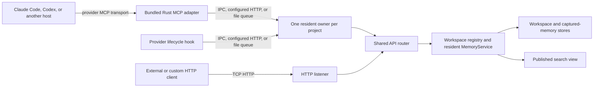

# Local IPC server architecture

Bundled Rust provider MCP adapters and lifecycle hooks send workspace requests
to one resident Membrick owner. They use local IPC first, an optional configured
loopback HTTP listener second, and a project-local file queue when socket
creation is blocked. Every transport reaches the same router, writer, and
`MemoryService` instance.

## Request path

The agent still connects to its provider MCP adapter using the transport
configured by that agent, commonly stdio. The adapter then forwards the tool
request to the resident owner over the operating system's local IPC mechanism.
The resident may expose IPC and HTTP listeners over the same application router
and `MemoryService` owner. The standalone HTTP server uses that router too, but
the workspace owner lock prevents it from opening a second writer for a project.



The IPC client sends HTTP/1 framed JSON requests through a Unix domain socket
on macOS and Linux, or a named pipe on Windows. This reuses the existing API
routes without opening a TCP port. Bundled provider adapters use the
workspace-aware MCP tool route; their hooks use the corresponding capture and
search routes.

## Automatic startup and endpoint security

The client first tries the workspace's resident IPC endpoint. If
`resident_http_bind` is configured in `.membrick/server.toml`, it next tries
that loopback HTTP listener. If both socket transports are unavailable, it
writes one atomic request file under the project's `.membrick/runtime/requests`
directory and waits for the resident to return a matching response file. If no
owner is available, the client starts resident-server mode. Concurrent first
requests coordinate through a kernel-backed startup lock in
`.membrick/runtime/`; the `.starting` marker is status metadata only. A starter
reclaims or replaces that marker only after acquiring the lock. The separate
workspace owner lock prevents a second resident or standalone HTTP process
from opening another writer for the same project.

The process that starts a resident watches it until an endpoint responds.
If the child exits before binding, the starter removes only its own marker and
reports the startup failure. If the starter itself exits or crashes, the OS
releases its startup lock. The next starter acquires that lock, replaces any
orphaned marker, and can launch a replacement resident.

Claude Code and Codex hooks use a project-configurable execution budget, which
defaults to 5 seconds and is capped at 10 seconds, plus at most 2 seconds for
a capture already in progress. A blocked file-queue request therefore fails
open promptly instead of holding the provider hook for the queue's full
request timeout.

Each workspace keeps its resident socket (macOS and Linux), startup marker,
owner lock, and diagnostics under its own `.membrick/runtime/` directory. On
Unix-like systems the directory is restricted to the current user and the
socket is restricted to its owner. Windows uses a workspace-specific named
pipe and the same project-scoped OS file locks for startup and resident
ownership. The OS releases these locks when a process exits or crashes; the
lock files may remain and are reused by the next owner. Different project roots
therefore use separate runtime state and endpoints without requiring access to
the user's home directory.

The provider-launched MCP adapter requests resident startup when its stdio MCP
process begins. That warm-up uses a short-lived kernel-locked lease in
`.membrick/runtime/provider-leases/`. Hooks and other one-shot clients hold
leases while a request is in flight. Every provider adapter (Claude, Codex,
Gemini CLI, AGY, Hermes, OpenClaw and Muse) also holds a keepalive lease while
it is in use, and releases it after five minutes with no tool call or hook it
can attribute to its sessions. Hooks mark activity under
`.membrick/runtime/provider-adapters/activity/`, once for their session and
once for their provider. An adapter that has seen session IDs (Codex threads)
follows only those sessions. An adapter that has not seen any follows every
hook from its provider in the project. Hosts can keep adapters and threads
open long after the user leaves without sending an end event, so no adapter
holds a lease for its whole process lifetime. The resident is shared by every
provider using the same project. After all request and keepalive leases
are released, the resident waits for `resident_idle_timeout_seconds` (60
seconds by default, clamped to 5–3600) before flushing its writer and shutting
down. A later provider or hook request starts a fresh resident automatically.
Stale lease files are detected by testing the kernel lock and removed during
the resident's lease scan. Lease registration and the resident's final
empty-lease check share the kernel lock at
`.membrick/runtime/provider-lifecycle.lock`. If a request starts while the
resident is shutting down, registration waits until the old resident has
closed its endpoints and flushed its writer; the request then starts a fresh
owner. The resident holds this lock through its shutdown path. Manual
`--resident-server` mode remains signal-controlled rather than idle-controlled.

The dashboard and direct HTTP listener are served by the resident. Once it has
idled out, direct browser access does not start it; a provider, hook, or other
Membrick client request must wake the resident first.

The shared `integrations::provider_lifecycle` manager stores adapter ownership
under `.membrick/runtime/provider-adapters`. Each ownership token contains the
provider, conversation ID, and provider-issued instance ID. End events match
all three fields. Ending an earlier instance cannot release a resumed instance
or another provider's ownership. Each provider integration translates its own
signals into these tokens; dropping an adapter releases its ownership record.

Codex adapters also bind the session IDs supplied by installed `SessionStart`
and `UserPromptSubmit` MCP hooks, or by a tool call's `_meta.threadId`. The
command `SessionEnd` hook releases that session's ownership under a project
lock. Once a bound adapter has no remaining sessions, its MCP loop returns
even if a Codex daemon still holds stdin open. Adapters shared by several
bound sessions stay up until the final session ends. `SubagentStop` releases a
bound subagent ID as well.

Codex currently supplies only a conversation ID in its end hook. Its bridge
therefore uses conversation-scoped ownership, without instance fencing. A
delayed end event for an earlier resume of the same conversation remains
ambiguous. The shared manager supports exact instance fencing, but the Codex
bridge cannot use it until the host supplies a matching instance ID on both
binding and end events. MCP tool metadata alone does not resolve that gap.

This requires the updated, trusted Codex hooks. `SessionStart` can run before
MCP initialization, so `UserPromptSubmit` retries binding. Clients without a
session binding retain the usual stdin-EOF lifecycle; Membrick cannot infer
their owning terminal. An abrupt disconnect that does not emit `SessionEnd`
still relies on the host closing the MCP connection. Such an adapter process
can stay alive, but it stops keeping the resident warm once its sessions go
idle. The Codex CLI ties its adapters to the terminal only when its managed
app-server daemon is off (`codex features disable daemon_auto_start`); the
Codex app keeps that daemon, and its adapters, running by design. See the
[Codex hook lifecycle](https://learn.chatgpt.com/docs/hooks#sessionend) for when
Codex emits this event.

Published read views share immutable temporal facts and semantic relationships
with the writer through copy-on-write ownership. Segmented stores keep search
postings in their segments instead of retaining a second corpus-wide posting
aggregate. Compatibility exports build the global aggregate only on demand.
Prepared checkpoints stream records through a compressed buffer, then stream
them back to ordinary JSON at the atomic disk write. This avoids retaining a
full serialized corpus string beside the live records.
This reduces duplication; document records, source text and active segment
indexes still occupy memory, and publishing changed segments can raise peaks.

On normal shutdown the resident stops accepting connections, flushes its
writer, and removes its socket file if the path still refers to the socket it
created. A socket left by a process that was killed outright is removed by the
next owner when it fails to connect to it.

Project installation creates `.membrick/server.toml` when it does not already
exist. It preserves an existing file. The installed port is selected for the
project from the loopback range `8465` through `9999`; the example below shows
one possible assignment:

```toml
bind = "127.0.0.1:8080"
resident_http_bind = "127.0.0.1:8465"
resident_http_auto_port = true
resident_idle_timeout_seconds = 60
dashboard_url = "http://127.0.0.1:8465/dashboard"
```

`bind` is the standalone HTTP server address. The bundled client reads
`resident_http_bind` and tries that loopback listener only after local IPC fails.
The dashboard URL points to the resident HTTP listener while the resident is
running. When multiple projects start concurrently with the same candidate, the
operating system grants the port to one resident; the other resident advances
to the next available port and atomically saves the selected bind and dashboard
URL. The HTTP fallback checks the listener's workspace identity before sending
any request, so a candidate collision can never route a project's memory call
to a different project. Later sessions for that project read the saved value. Set
`resident_http_auto_port = false` to keep a manually chosen resident port fixed.
If both socket transports are blocked, the file queue uses atomic rename to
claim each request once and routes it through the same resident router. A
timeout after a request was claimed reports that its outcome may be unknown;
Membrick does not replay the operation with a new identifier. When a resident
restarts, it turns leftover claims into a `503` response that says the outcome
is unknown, then removes the claim. This avoids repeating a write that may
already have reached `MemoryService`. Pending requests and orphaned responses
are retained for 24 hours, then removed; incomplete temporary files follow the
same retention period. Cleanup runs at resident startup and every 15 minutes.
The startup recovery handles claims only after the previous resident has lost
the project owner lock, so an active request is never mistaken for an orphan.

## Resident memory ownership

`MemoryService` remains the only entry point for reads and writes. The writer
and published search views share immutable source documents and processed
records through `Arc`. Replacing one document copies that document when an
older reader still uses it; an unrelated write does not copy every document's
content. Retired views release their entries when their last reader finishes.

Published combined views reuse the segment indexes and omit the writer's
semantic posting aggregate. Cross-document semantic relations and temporal
facts remain available to retrieval. Checkpoints serialize borrowed records,
and startup parses persisted JSON through a buffered reader, avoiding an extra
copy of the complete file. The persisted record format is unchanged.

Removing or replacing documents also removes obsolete pending posting keys.
Persistent services cache at most 512 adjudication receipts after successful
persistence. The existing receipt snapshot and journal retain the full history;
older retries stream that history to recover the exact receipt. Failed receipt
writes remain pinned in memory and are retried before eviction. Services with
no persistent backing retain their receipts to preserve retry behavior.
Request fingerprints remain the compact idempotency ledger, so the service can
reject a reused request ID with different content.

These changes reduce retained and temporary copies without discarding captured
observations, source documents, or recorded MCP calls. Resident footprint still
depends on corpus size, derived indexes, concurrent readers, and publication.

## Relationship to the HTTP server

The standalone HTTP API remains available for applications, custom clients,
and integrations that are configured to use HTTP. It is useful when clients
need an explicit service boundary or access from another machine. Its network
interface and authentication are configured through server settings and
command-line options.

The resident can optionally expose a TCP HTTP listener alongside IPC. The
standalone HTTP mode remains available for applications and custom clients. A
workspace store has one active writer owner across both modes; starting a second
server against that project fails before it opens the store. See the
[HTTP server guide](server.md) for network configuration and the
[agent connection guide](connect-agent.md#mcp-tools) for provider tools.

Some integrations, including plugins configured independently from the
bundled Rust adapters, may still call HTTP endpoints. This does not change the
transport used by bundled Rust MCP adapters and hooks.

## Local transport comparison

A short diagnostic compared the two transports through the same
`/provider-memory/mcp/tools/call` handler. Each run lasted 10 seconds with four
search callers and one writer adding one memory per call. Both used a seeded
isolated workspace, opened a fresh connection per request, returned no errors,
and made the last acknowledged write searchable.

| Transport | Search requests/s | Search p50 / p95 / p99 | Writes/s | Write p50 / p95 / p99 |
|---|---:|---:|---:|---:|
| HTTP over loopback TCP | 76.97 | 51.8 / 64.4 / 68.2 ms | 11.15 | 87.9 / 101.7 / 103.4 ms |
| Local IPC over Unix socket | 79.95 | 48.9 / 64.1 / 74.0 ms | 11.75 | 82.0 / 97.4 / 99.8 ms |

This was one short run per transport, so the small differences are within the
scope of machine and run variation. It does not show a meaningful throughput
advantage for either transport. The result indicates that using IPC does not
materially reduce throughput for this MCP workload. It does not measure Windows
named-pipe performance or large production corpora.
