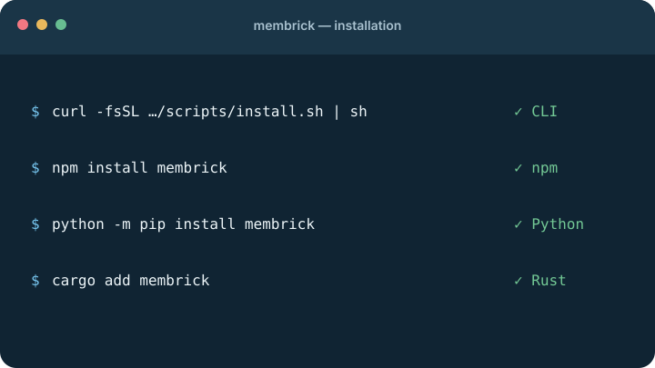
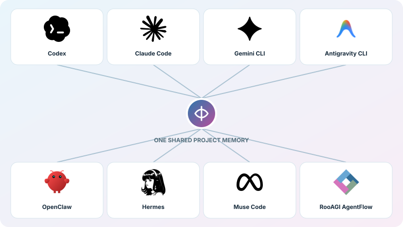
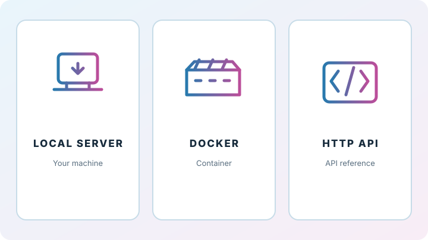

# Get started

Download Membrick, save a few things you want your assistant to remember, and
ask questions in plain language. You do not need to build the project or learn
special memory syntax.

## Choose a path

Pick a starting point. Each path shows you what Membrick looks like in use and
links to the setup details below.

<div class="grid cards quickstart-paths" markdown>

-   **Installation and update**

    { .quickstart-illustration }

    [Installation and update steps](#1-download-or-update-membrick)

    Install with Python or npm, or use the Rust crate or download a release
    from GitHub.

-   **Add your first memory**

    { .quickstart-illustration }

    [Add a memory](#2-add-your-first-memory) · [View the dashboard](observability.md)

    Add memory from files, your agent, or an application. Inspect what Membrick
    has indexed in the dashboard.

-   **Connect agents**

    { .quickstart-illustration }

    Connect one of the eight supported agents to the same project memory.

    [Choose your agent](connect-agent.md)

-   **Hosting Membrick**

    { .quickstart-illustration }

    Run Membrick locally, package it with Docker, or connect an application
    through the HTTP API.

    [Local server](server.md) · [Docker](docker.md) · [API reference](api/index.md)

</div>

## 1. Download or Update Membrick

### Install Membrick

#### Ask Codex or Claude Code to install it

Paste this prompt into Codex or Claude Code while the project you want to
connect is open. The agent will install Membrick, configure the current project,
and verify the connection using the official installer. Approve its terminal
commands when prompted.

<div class="install-prompt-scroll" markdown>

```text
Install Membrick for this project.

1. Identify whether you are running in Codex or Claude Code, and detect the
   operating system. Confirm the current project root. If you cannot identify
   the agent or project root, ask me before changing any configuration.
2. If the `membrick` command is already installed, run `membrick install`
   for the identified agent with the current project as its path, then run
   `membrick verify` for that agent and project. Do not reinstall the CLI.
3. Otherwise, use Membrick's official installer for this operating system,
   passing the identified agent and current project so installation and setup
   happen together:
   - macOS or Linux: download and run
     `curl -fsSL https://raw.githubusercontent.com/RooAGI/Membrick/main/scripts/install.sh | sh -s -- --agent <agent> --project .`,
     replacing `<agent>` with `codex` or `claude`.
   - Windows PowerShell: download the official script to a temporary file,
     run it with `-Agent <agent> -Project .`, then remove the temporary file.
     Use `Invoke-WebRequest` to download it from
     https://raw.githubusercontent.com/RooAGI/Membrick/main/scripts/install.ps1.
4. Report the installed version and whether Membrick verification succeeded.
   If installation or verification fails, stop and explain the error. If the
   agent needs a restart to load the integration, tell me.

Use only the official Membrick installer above. Do not change unrelated agent
settings or project files.
```

</div>

#### Install manually

Choose one of these four CLI installation methods:

#### Python CLI (PyPI)

```bash
pipx install membrick
```

#### npm CLI

```bash
npm install --global membrick
```

#### Rust CLI (Cargo)

```bash
cargo install membrick --locked
```

#### GitHub release

On macOS or Linux:

```bash
curl -fsSL https://raw.githubusercontent.com/RooAGI/Membrick/main/scripts/install.sh | sh
```

On Windows, run this in PowerShell:

```powershell
irm https://raw.githubusercontent.com/RooAGI/Membrick/main/scripts/install.ps1 | iex
```

The installers download and verify the release binary. You can also download
the [latest release directly](https://github.com/RooAGI/Membrick/releases/latest).

### Update Membrick

Use the command for the method you installed with:

#### Python CLI (PyPI)

```bash
pipx upgrade membrick
```

#### npm CLI

```bash
npm update -g membrick
```

#### Rust CLI (Cargo)

```bash
cargo install membrick --locked --force
```

#### GitHub release

Rerun the platform installer to update Membrick. On macOS or Linux:

```bash
curl -fsSL https://raw.githubusercontent.com/RooAGI/Membrick/main/scripts/install.sh | sh
```

On Windows, run this in PowerShell:

```powershell
irm https://raw.githubusercontent.com/RooAGI/Membrick/main/scripts/install.ps1 | iex
```

If you installed the Windows executable directly, replace it with the latest
version from the [releases page](https://github.com/RooAGI/Membrick/releases/latest).

You can also approve the `update_membrick` action in your connected agent, if
it is available.

After installation or update, open a new terminal and check the installed
version. On Windows, use the standalone executable command shown above.

```bash
membrick --version
```

After updating, fully quit and reopen Codex, Claude Code, or the agent client
you use. This reconnects its MCP server to the updated Membrick. For details
about update notices and approval, see
[Update notifications](update-notifications.md).

## 2. Add your first memory

Choose how you want to add a memory. With a connected agent, you can ask it to
remember something in the conversation. For direct use, pick the CLI, an SDK,
or the HTTP API.

=== "Connected AI agent"

    Ask your connected agent to remember something, for example:

    > Remember that I prefer concise answers with a short summary first.

    The agent saves it through Membrick. See [agent setup](connect-agent.md) if
    Membrick is not connected yet.

=== "Python"

    Install the package with `pip install membrick`. Use `Memory.init(...)` to
    initialize project state explicitly. `Memory(path=...)` connects to an
    existing project without creating files.

    ```python
    from membrick import Memory

    memory = Memory.init(path=".")
    receipt = memory.add(
        [{"role": "user", "content": "I prefer concise answers with a short summary first."}],
        user_id="local-user",
    )
    hits = memory.search("How do I prefer answers?", user_id="local-user")
    ```

=== "Node.js"

    Install the package with `npm install membrick`. Use `Memory.init(...)` to
    initialize project state explicitly. `new Memory({ path })` connects to an
    existing project without creating files.

    ```js
    import { Memory } from 'membrick'

    const memory = Memory.init({ path: process.cwd() })
    const receipt = await memory.add(
      [{ role: 'user', content: 'I prefer concise answers with a short summary first.' }],
      'local-user',
    )
    const hits = await memory.search('How do I prefer answers?', 'local-user')
    ```

=== "Rust"

    Add the crate with `cargo add membrick`. Call `Memory::init(path)` to
    initialize a new project, or `Memory::new(path)` to connect to an existing
    one:

    ```rust
    use membrick::{AddOptions, Memory, Message, SearchOptions};

    let memory = Memory::init(".")?;
    let receipt = memory.add(
        vec![Message {
            role: "user".into(),
            content: "I prefer concise answers with a short summary first.".into(),
            timestamp: None,
            expires_at_ms: None,
            supersedes_id: None,
        }],
        "local-user",
        AddOptions::default(),
    )?;
    let hits = memory.search("How do I prefer answers?", "local-user", SearchOptions::default())?;
    ```

=== "HTTP API"

    Start the [local HTTP server](server.md), then send an add request:

    ```bash
    curl -X POST 'http://127.0.0.1:8080/v1/memories?wait_for_visibility=true' \
      -H 'Content-Type: application/json' \
      -d '{
        "request_id": "quickstart-001",
        "user_id": "local-user",
        "session_id": "quickstart",
        "messages": [
          {"role": "user", "content": "I prefer concise answers with a short summary first."}
        ]
      }'
    ```

    If the server requires authentication, also send an `Authorization: Bearer`
    header. See the [full Add API reference](api/add.md) for request fields,
    retries, and responses.

=== "CLI notes"

    Save personal notes as plain text or Markdown files. Write naturally;
    Membrick searches the words and ideas in each file.

    ```bash
    mkdir -p ~/my-assistant-memory
    cat > ~/my-assistant-memory/preferences.md <<'EOF'
    I prefer concise answers with a short summary first.
    When explaining code, include a small example.
    EOF
    ```

    You can find these notes with `membrick query`:

    ```bash
    membrick query "How do I prefer answers to be written?" ~/my-assistant-memory
    ```

The SDK and HTTP API generate a `request_id` when you omit one. If your
application must recover from an uncertain result, provide a durable ID and
reuse it only when retrying the same request. Project-mode SDK clients connect
to the local resident, which owns the data under
`.membrick/memory`; use `base_url` to connect to an HTTP service.

## 3. Search your memories

Search the memory you added above using the same `user_id`. Choose the interface
you are using:

=== "Connected AI agent"

    Ask your connected agent a question, for example:

    > How do I prefer answers to be written?

    The agent searches your Membrick memories and uses the relevant results to
    answer. See [agent setup](connect-agent.md) if Membrick is not connected yet.

=== "Python"

    Continue with the `memory` client from the previous step:

    ```python
    hits = memory.search(
        "How do I prefer answers?",
        user_id="local-user",
        top_k=5,
    )
    for hit in hits:
        print(hit["content"])
    ```

=== "Node.js"

    Continue with the `memory` client from the previous step:

    ```js
    const hits = await memory.search(
      'How do I prefer answers?',
      'local-user',
      { topK: 5 },
    )
    for (const hit of hits) {
      console.log(hit.content)
    }
    ```

=== "Rust"

    Continue with the `memory` client from the previous step:

    ```rust
    use membrick::SearchOptions;

    let hits = memory.search(
        "How do I prefer answers?",
        "local-user",
        SearchOptions {
            top_k: 5,
            ..Default::default()
        },
    )?;
    for hit in hits {
        println!("{}", hit.content);
    }
    ```

=== "HTTP API"

    Search the same owner scope through the local server:

    ```bash
    curl -X POST 'http://127.0.0.1:8080/v1/memories/search' \
      -H 'Content-Type: application/json' \
      -d '{
        "query": "How do I prefer answers?",
        "user_id": "local-user",
        "top_k": 5
      }'
    ```

    If the server requires authentication, also send an `Authorization: Bearer`
    header. The response contains matching records in its `data` array. See the
    [Search API reference](api/search.md) for filters and session context.

=== "CLI notes"

    For the Markdown notes created in the previous step, query the folder:

    ```bash
    membrick query "How do I prefer answers to be written?" ~/my-assistant-memory
    ```

    To print a short answer context that you can paste into an AI assistant, use
    the `context` command:

    ```bash
    membrick context "How do I prefer answers to be written?" ~/my-assistant-memory
    ```

    Ask a new question whenever you want to look something up. To show more
    matches, add `--count 10`.

To see which indexes already exist in the current project, run
`membrick status .`. This only inspects existing index stores; it does not scan
project files.

## 4. Change or forget a memory

Use a memory ID from the search results and the same `user_id` that owns it.
Choose the interface you are using:

=== "Connected AI agent"

    Tell your agent what changed or what to forget, for example:

    > I no longer prefer concise answers. Forget that preference.

    The agent can update or delete the matching memory through Membrick. See
    [agent setup](connect-agent.md) if Membrick is not connected yet.

=== "Python"

    Continue with the `memory` client and `hits` from the search step:

    ```python
    memory_id = hits[0]["id"]

    updated = memory.update(
        memory_id,
        "local-user",
        "I prefer detailed answers with examples.",
        role="user",
    )

    deleted = memory.delete(memory_id, "local-user")
    ```

    Updating keeps the memory ID. Delete permanently removes the memory.

=== "Node.js"

    Continue with the `memory` client and `hits` from the search step:

    ```js
    const memoryId = hits[0].id

    const updated = await memory.update(
      memoryId,
      'local-user',
      'I prefer detailed answers with examples.',
      { role: 'user' },
    )

    const deleted = await memory.delete(memoryId, 'local-user')
    ```

    Updating keeps the memory ID. Delete permanently removes the memory.

=== "Rust"

    Continue with the `memory` client and `hits` from the search step:

    ```rust
    use membrick::UpdateOptions;

    let memory_id = &hits[0].id;
    let updated = memory.update(
        memory_id,
        "local-user",
        "I prefer detailed answers with examples.",
        UpdateOptions {
            role: Some("user".into()),
            ..Default::default()
        },
    )?;

    let deleted = memory.delete(memory_id, "local-user")?;
    ```

    Updating keeps the memory ID. Delete permanently removes the memory.

=== "HTTP API"

    Set `MEMORY_ID` to the `id` from the search response, then update it:

    ```bash
    export MEMORY_ID='<memory-id-from-search>'

    curl -X PATCH "http://127.0.0.1:8080/v1/memories/$MEMORY_ID" \
      -H 'Content-Type: application/json' \
      -d '{
        "user_id": "local-user",
        "content": "I prefer detailed answers with examples.",
        "role": "user"
      }'
    ```

    To forget it, send a delete request:

    ```bash
    curl -X DELETE "http://127.0.0.1:8080/v1/memories/$MEMORY_ID?user_id=local-user"
    ```

    Add an `Authorization: Bearer` header to both requests if the server
    requires authentication. See the [Update](api/update.md) and
    [Delete](api/delete.md) references for details.

=== "CLI notes"

    For file-based notes, edit the file to change its contents, then query the
    folder again. Remove a note to forget it:

    ```bash
    $EDITOR ~/my-assistant-memory/preferences.md
    membrick query "How do I prefer answers to be written?" ~/my-assistant-memory
    rm ~/my-assistant-memory/preferences.md
    ```

    You can also move the file outside `~/my-assistant-memory` to keep it
    without including it in searches of that folder.
